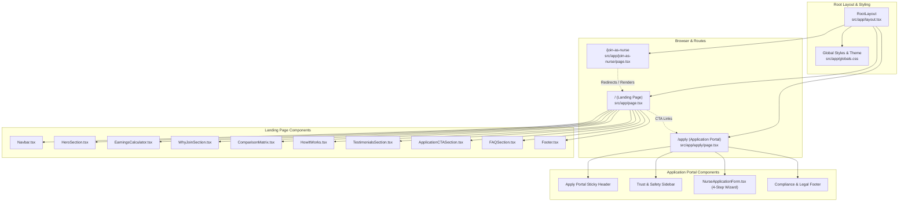

# NurseNow — Project Architecture & File Structure

This document outlines the complete architectural layout, directory structure, module responsibilities, and data flows of the **NurseNow** project.

---

## 1. High-Level Technology Stack

- **Framework:** [Next.js 16 (App Router)](https://nextjs.org/)
- **UI Library:** [React 19](https://react.dev/)
- **Language:** [TypeScript 5](https://www.typescriptlang.org/)
- **Styling:** [Tailwind CSS v4](https://tailwindcss.com/) with custom `@theme` brand tokens
- **Typography:** [Google Fonts (Manrope & Inter)](https://fonts.google.com/) via `next/font/google`
- **Icons:** [lucide-react](https://lucide.dev/)
- **Linting:** [ESLint 9](https://eslint.org/) with `eslint-config-next`

---

## 2. Complete Project File Tree

```
NurseNow/
├── .gitignore                                  # Git exclusion patterns
├── AGENTS.md                                   # Next.js dev server agent guidance & rules
├── eslint.config.mjs                           # Modern ESLint 9 configuration
├── next-env.d.ts                               # Next.js TypeScript ambient type definitions
├── next.config.ts                              # Next.js compiler & runtime configurations
├── package.json                                # Project dependencies, scripts, and metadata
├── package-lock.json                           # Deterministic dependency tree lockfile
├── README.md                                   # Standard getting-started documentation
├── tsconfig.json                               # TypeScript compiler configuration & path aliases
│
├── docs/                                       # Project documentation & design specifications
│   ├── architecture.md                         # Complete project architecture & file structure (this file)
│   ├── design.md                               # Brand identity, design system, colors, & typography
│   └── idea.md                                 # Product concept, problem statement, & feature scope
│
├── public/                                     # Static public assets served from root
│   ├── file.svg                                # Vercel default file vector asset
│   ├── globe.svg                               # Vercel default globe vector asset
│   ├── next.svg                                # Next.js brand vector asset
│   ├── vercel.svg                              # Vercel logo vector asset
│   └── window.svg                              # Vercel default window vector asset
│
└── src/                                        # Application source code
    ├── app/                                    # Next.js App Router root
    │   ├── apply/                              # Nurse partner application portal route
    │   │   └── page.tsx                        # Official multi-step application page & layout
    │   ├── join-as-nurse/                      # Campaign redirect / nurse portal landing route
    │   │   └── page.tsx                        # Dedicated nurse partner route
    │   ├── favicon.ico                         # Platform browser tab icon
    │   ├── globals.css                         # Tailwind v4 theme definitions & base styles
    │   ├── layout.tsx                          # Root HTML layout with Google Font bindings
    │   └── page.tsx                            # Primary marketing landing page
    │
    └── components/                             # Modular reusable UI components
        ├── ApplicationCTASection.tsx           # Closing banner prompting nurses to apply
        ├── ComparisonMatrix.tsx                # Feature comparison: NurseNow vs Traditional Hospital Staffing
        ├── EarningsCalculator.tsx              # Interactive dynamic earnings & shift rate calculator
        ├── FAQSection.tsx                      # Categorized interactive accordion FAQ
        ├── Footer.tsx                          # Global footer with navigation links & trust badges
        ├── HeroSection.tsx                     # Landing hero banner with live staffing simulation card
        ├── HowItWorks.tsx                      # 4-step nurse & hospital onboarding workflow
        ├── Navbar.tsx                          # Responsive sticky top navigation bar with mobile menu
        ├── NurseApplicationForm.tsx            # Multi-step nurse registration & verification form
        ├── TestimonialsSection.tsx             # Nurse partner reviews, quotes, and hospital ratings
        └── WhyJoinSection.tsx                  # Core value props grid (weekly payouts, flexibility, ward choice)
```

---

## 3. Detailed Component & File Directory Breakdown

### 3.1 Root Configuration & Tooling

| File | Purpose |
| :--- | :--- |
| [`package.json`](file:///c:/Drive/NurseNow/package.json) | Manages package dependencies (`next`, `react`, `lucide-react`, `tailwindcss`) and npm build scripts (`dev`, `build`, `start`, `lint`). |
| [`tsconfig.json`](file:///c:/Drive/NurseNow/tsconfig.json) | Configures strict TypeScript transpilation, bundling rules, and the `@/*` module alias pointing to `./src/*`. |
| [`next.config.ts`](file:///c:/Drive/NurseNow/next.config.ts) | Next.js runtime configuration module. |
| [`eslint.config.mjs`](file:///c:/Drive/NurseNow/eslint.config.mjs) | ESLint configuration file extending Next.js core Web Vitals and TypeScript rules. |
| [`next-env.d.ts`](file:///c:/Drive/NurseNow/next-env.d.ts) | Ambient type declarations managed by Next.js. |
| [`.gitignore`](file:///c:/Drive/NurseNow/.gitignore) | Filters out `node_modules`, build outputs (`.next`), environment files (`.env*`), and IDE caches. |
| [`AGENTS.md`](file:///c:/Drive/NurseNow/AGENTS.md) | Agent reference rules generated and maintained by Next.js dev server. |
| [`README.md`](file:///c:/Drive/NurseNow/README.md) | Default repository setup guide and script execution commands. |

---

### 3.2 Product & Engineering Documentation (`docs/`)

| File | Purpose |
| :--- | :--- |
| [`docs/architecture.md`](file:///c:/Drive/NurseNow/docs/architecture.md) | Comprehensive system architecture, file map, directory breakdown, and component graph. |
| [`docs/design.md`](file:///c:/Drive/NurseNow/docs/design.md) | Design token specifications: Deep Teal (`#0D9488`), Dark Navy (`#142D3A`), Warm White (`#FAFCFB`), Pale Mint (`#E8F5F1`), typography scale, and dual-audience UI specs. |
| [`docs/idea.md`](file:///c:/Drive/NurseNow/docs/idea.md) | High-level product summary, market context ("Pronto for Healthcare"), core value propositions, and future roadmap. |

---

### 3.3 Application Core & Routing (`src/app/`)

| File / Folder | Route Path | Description |
| :--- | :--- | :--- |
| [`src/app/layout.tsx`](file:///c:/Drive/NurseNow/src/app/layout.tsx) | Root Layout | Configures the HTML shell, injects CSS variables for `Manrope` and `Inter` via `next/font/google`, and defines global SEO metadata. |
| [`src/app/globals.css`](file:///c:/Drive/NurseNow/src/app/globals.css) | Global Styles | Tailwind CSS v4 `@theme` block defining custom colors (`--color-teal-brand`, `--color-navy-brand`, etc.) and typography defaults. |
| [`src/app/page.tsx`](file:///c:/Drive/NurseNow/src/app/page.tsx) | `/` | Main public marketing and nurse recruitment landing page. Composes all landing sections sequentially. |
| [`src/app/apply/page.tsx`](file:///c:/Drive/NurseNow/src/app/apply/page.tsx) | `/apply` | Dedicated full-page partner hiring portal containing trust highlights, helpline banner, and the interactive [NurseApplicationForm](file:///c:/Drive/NurseNow/src/components/NurseApplicationForm.tsx). |
| [`src/app/join-as-nurse/page.tsx`](file:///c:/Drive/NurseNow/src/app/join-as-nurse/page.tsx) | `/join-as-nurse` | Specialized promotional/campaign route serving nurse onboarding. |
| [`src/app/favicon.ico`](file:///c:/Drive/NurseNow/src/app/favicon.ico) | Static Icon | Platform favicon displayed in the browser tab bar. |

---

### 3.4 UI Component Library (`src/components/`)

All modular, presentation, and interactive components are organized under `src/components/`:

| Component | Responsibility & Features |
| :--- | :--- |
| [`Navbar.tsx`](file:///c:/Drive/NurseNow/src/components/Navbar.tsx) | Responsive navigation header with brand badge, desktop menu links (`For Hospitals`, `For Nurses`, `Earnings`, `FAQ`), mobile drawer toggle, and CTA button linking to `/apply`. |
| [`HeroSection.tsx`](file:///c:/Drive/NurseNow/src/components/HeroSection.tsx) | High-impact hero section showcasing the core proposition, primary CTAs (`Apply Now`, `Explore Earnings`), social trust badges, and an interactive real-time shift matching simulator preview card. |
| [`EarningsCalculator.tsx`](file:///c:/Drive/NurseNow/src/components/EarningsCalculator.tsx) | Interactive earnings estimation tool allowing nurses to adjust clinical tier (General, ICU, Emergency, OT) and weekly shifts to calculate projected monthly income and hourly rates. |
| [`WhyJoinSection.tsx`](file:///c:/Drive/NurseNow/src/components/WhyJoinSection.tsx) | Value pillars grid displaying 4 core nurse advantages: Guaranteed Weekly Payouts, Ward & Shift Choice, Zero Commission Middlemen, and Comprehensive Professional Insurance. |
| [`ComparisonMatrix.tsx`](file:///c:/Drive/NurseNow/src/components/ComparisonMatrix.tsx) | Side-by-side feature comparison table contrasting NurseNow flexible contract nursing against traditional hospital staffing models. |
| [`HowItWorks.tsx`](file:///c:/Drive/NurseNow/src/components/HowItWorks.tsx) | Sequential 4-step onboarding journey: 1. Quick Verification → 2. Choose Shifts → 3. Work Shifts → 4. Direct Weekly Bank Payouts. |
| [`TestimonialsSection.tsx`](file:///c:/Drive/NurseNow/src/components/TestimonialsSection.tsx) | Social proof cards featuring real nurse testimonials, verified credentials badges, hospital partners, and satisfaction metrics. |
| [`ApplicationCTASection.tsx`](file:///c:/Drive/NurseNow/src/components/ApplicationCTASection.tsx) | High-conversion bottom callout section urging nurses to begin their registration with instant document upload. |
| [`FAQSection.tsx`](file:///c:/Drive/NurseNow/src/components/FAQSection.tsx) | Accordion component addressing common questions regarding State Nursing Council checks, shift cancellation policies, and payment cycles. |
| [`NurseApplicationForm.tsx`](file:///c:/Drive/NurseNow/src/components/NurseApplicationForm.tsx) | Comprehensive 4-step interactive application wizard: Personal Information, Professional Credentials & Council Registration, Preferred Shifts & Locations, and Document Verification Upload. |
| [`Footer.tsx`](file:///c:/Drive/NurseNow/src/components/Footer.tsx) | Footer containing brand information, quick links, hospital portal access, regulatory compliance statement, and contact details. |

---

## 4. Architectural Diagram & Component Flow



---

## 5. Architectural Conventions & Guidelines

1. **Path Aliasing:** Use `@/*` to reference modules within `src/` (e.g., `import Navbar from "@/components/Navbar"`).
2. **Server vs. Client Components:**
   - Static pages and wrappers default to Next.js Server Components.
   - Interactive widgets utilizing React state, hooks, or event listeners (such as [`EarningsCalculator.tsx`](file:///c:/Drive/NurseNow/src/components/EarningsCalculator.tsx), [`FAQSection.tsx`](file:///c:/Drive/NurseNow/src/components/FAQSection.tsx), and [`NurseApplicationForm.tsx`](file:///c:/Drive/NurseNow/src/components/NurseApplicationForm.tsx)) are explicitly marked with `"use client"`.
3. **Design System Integration:** All custom colors (`teal-brand`, `navy-brand`, `mint-brand`) must strictly reference the design tokens declared in [`src/app/globals.css`](file:///c:/Drive/NurseNow/src/app/globals.css) and [`docs/design.md`](file:///c:/Drive/NurseNow/docs/design.md).
4. **Responsive Strategy:** Mobile-first approach using Tailwind utility classes (`sm:`, `md:`, `lg:`, `xl:`) ensuring full accessibility across smartphones, tablets, and desktop workstations.
